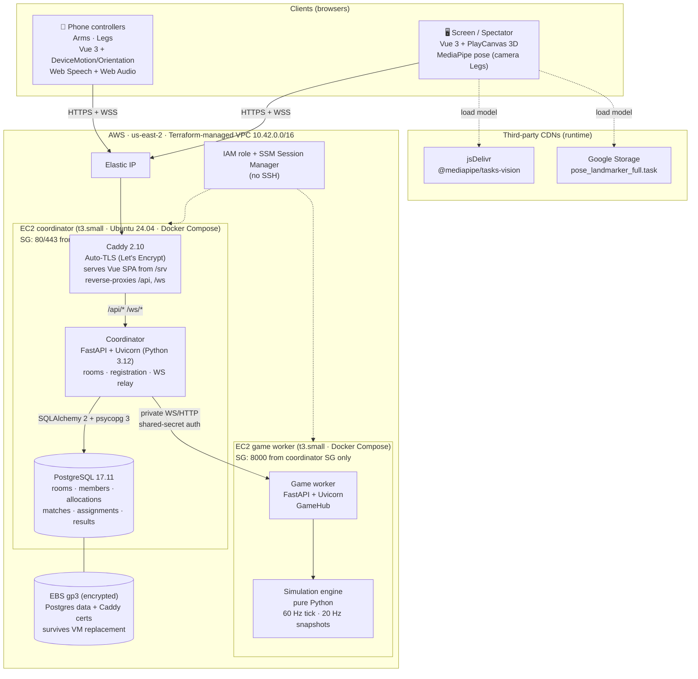
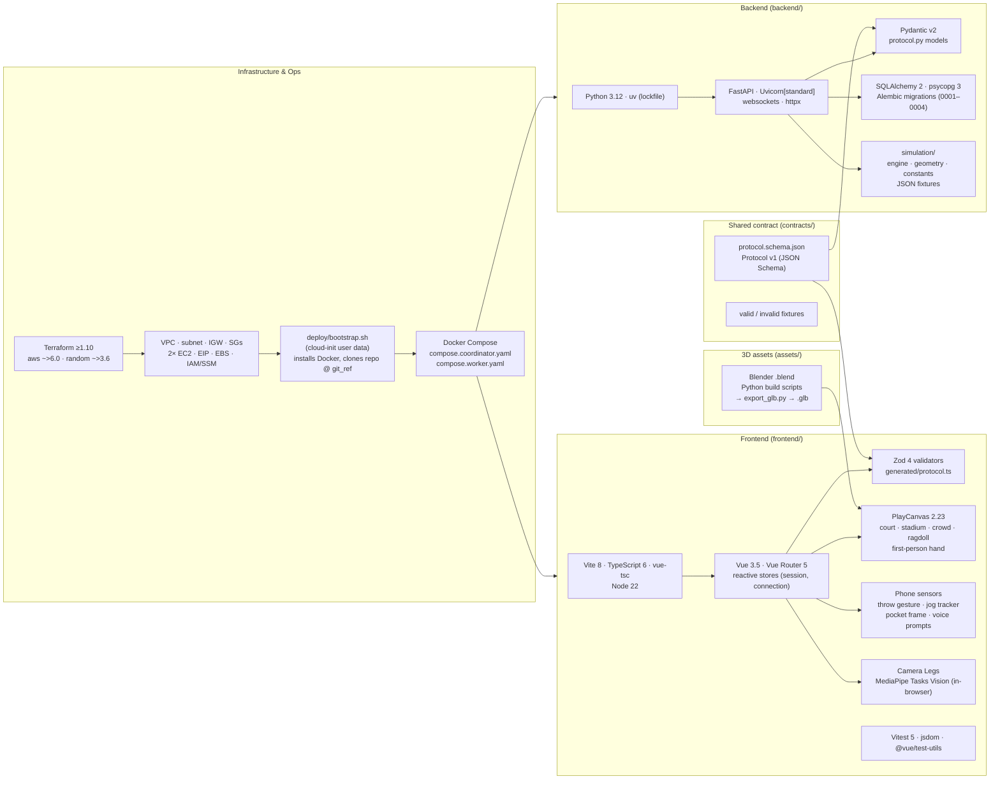
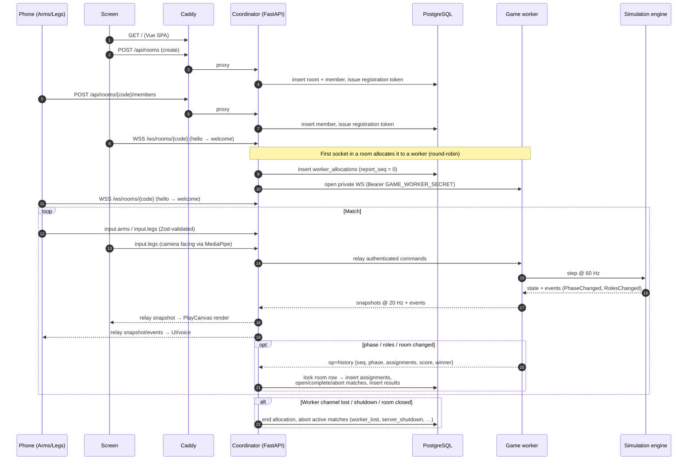

# dodgewuh — Tech Stack

Four phones and a shared screen control two dodgeball characters. This page maps every
layer of the project, from AWS infrastructure to the browser.

## System overview

## Layer by layer

## Request & game-loop flow

**How match history is recorded.** History is written throughout the match, not in
one write at the end. The game worker reports to the coordinator, and the coordinator
writes to PostgreSQL.

1. `GameRoom._flush` (`backend/app/services/game.py`) calls `report_history` when the
   phase changes, the roles change, or the room changes.
2. `report_history` (`backend/app/worker.py`) sends only five fields: `phase`,
   `assignment_version`, `assignments`, `score` and `winner`. It skips the report when
   nothing changed. Each report gets a sequence number (`seq`), and the worker queues it
   as `op: "history"` on the private channel to the coordinator.
3. `WorkerRoom.run` (`backend/app/services/workers.py`) receives the report.
   `Rooms.report` (`backend/app/services/rooms.py`) then locks the room row and
   checks that the allocation is still active.
4. `HistoryRepository.report` (`backend/app/repositories/history.py`) ignores reports
   it has already seen and raises an error if a sequence number is skipped. It records
   each new role assignment version in `assignments`. It opens a `matches` row on
   `countdown` or `active`. On `match_end` it marks the match `completed` and inserts
   the winner and score into `results`. A return to `lobby` marks the match `aborted`.
5. `HistoryRepository.end` closes `worker_allocations` and aborts any active match.
   This happens when a worker is lost (`worker_lost`), when the coordinator restarts
   (`server_restart`), when the server shuts down, or when the room closes.

## Stack summary

| Layer | Technology |
| --- | --- |
| Cloud | AWS (us-east-2): VPC, EC2 t3.small ×2, Elastic IP, encrypted EBS gp3, IAM, SSM Session Manager |
| IaC | Terraform (`hashicorp/aws ~> 6.0`, `hashicorp/random ~> 3.6`) |
| Provisioning | cloud-init user data → `deploy/bootstrap.sh` (Docker CE, swap, git checkout, compose up) |
| Containers | Docker, Docker Compose (local `compose.yaml`; prod coordinator/worker files) |
| Edge / TLS / static | Caddy 2.10 (automatic HTTPS, SPA fallback, zstd/gzip, immutable asset caching) |
| Backend runtime | Python 3.12, uv, FastAPI, Uvicorn, websockets, httpx |
| Validation | Pydantic v2 (backend), Zod 4 (frontend), shared JSON Schema in `contracts/` |
| Database | PostgreSQL 17.11, SQLAlchemy 2, psycopg 3, Alembic |
| Game simulation | Pure-Python authoritative engine on the worker (60 Hz tick, 20 Hz snapshots) |
| Frontend | Vue 3.5, Vue Router 5, TypeScript 6, Vite 8 |
| 3D rendering | PlayCanvas 2.23 (+ `.glb` models authored in Blender via Python scripts) |
| Input | DeviceMotion/DeviceOrientation (phones), MediaPipe Tasks Vision pose (screen camera), Web Speech + Web Audio |
| Testing | Vitest, jsdom, @vue/test-utils; JSON contract fixtures; simulation fixtures |
| Build images | `node:22-bookworm-slim` → `caddy:2.10.2`; `python:3.12-slim-bookworm` + uv |
