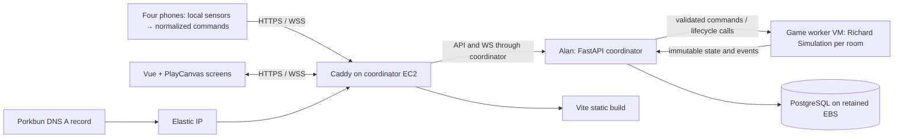

# Architecture

> **Architecture amendment:** dodgewuh uses Docker, a coordinator VM plus game worker VM(s), and PostgreSQL for durable records. [Persistence plan](11-sql-persistence.md) supersedes earlier single-process, no-database and systemd-backend instructions. Public message schemas remain unchanged; live simulations stay in worker memory.

> **Current project instruction — dodgewuh:** Do not create automated tests, test files, test suites, test harnesses or test-only dependencies. Do not add pytest, Vitest or Playwright, or require automated test commands for milestones, handoffs or deployment. Verify work through builds, type checks, runtime validation and manual API, browser, device and multiplayer checks. Keep useful protocol examples and runtime validators. Any remaining historical references to tests or test directories are not instructions to implement them. This instruction supersedes earlier testing requirements in this document.

Target design: a 2v2 cooperative motion dodgeball game in which four humans control two characters. In current local Compose, Richard's pure Python simulation runs in the FastAPI coordinator; the separate worker container is not yet used for room allocation or routing. PostgreSQL owns registration records. Vue 3 + TypeScript + Vite wraps a code-first PlayCanvas renderer. Production worker orchestration and deployment remain future work.

## Boundaries and runtime

Richard owns movement, ball state, collision, scores, clocks, phases, role swapping and snapshots. No AWS, socket, framework, or wall-clock imports in simulation. Alan owns identity, membership, connection health, command authorization, bounded queues, orchestration and broadcast. Alan passes connectivity/readiness to the simulation; he does not reproduce game rules. Ryan owns scene, snapshot transforms and display UI. Morteza and Tysen emit normalized commands; raw sensor streams never leave phones.

Each room uses a single serialized mutation path. A monotonic accumulator schedules fixed steps; limit catch-up to five steps per wake. If backlog exceeds 250 ms, reset the room to lobby as overloaded and log it, rather than skipping authoritative collision steps. Networking must never await a slow socket inside the simulation step. Separate sender tasks have bounded queues: latest snapshot replaces pending snapshot; reliable lifecycle events have a 32-message queue, with slow clients disconnected on overflow. Room mutations and commands execute on the same asyncio event loop. One Uvicorn worker, no production auto-reload.

## Browser composition

Ryan creates one PlayCanvas Application against a canvas during Vue mount; destroys it and resize/render subscriptions on unmount. Keep engine entities outside deep Vue reactivity. Primitive court, two capsules, four spheres, camera, lights, ownership indicator and aim arrow are sufficient. Vue owns lobby, HUD and transition overlays. PlayCanvas rigid-body physics is not enabled. Static geometry uses gameplay constants; visuals never send position, hit or score messages.

All screens have identical status and receive the same full snapshots. Render the latest snapshot for the first working MVP. Only after multiplayer is functional, optionally buffer 100 ms and interpolate transforms within the same round/epoch. Discrete possession, phase and score changes snap to authoritative values. On phase reset discard the transform buffer. No extrapolation or client prediction in MVP. A stale stream freezes with a connection overlay; late join gets a full baseline. Phone UI uses the same snapshots for possession and throw-zone feedback.

## Device and security lifecycle

Creator is a screen and immutable host. Join page collects code, then screen/phone selection; REST registration assigns a room-scoped member and bearer token. Four phone slots fill T1 Arms, T1 Legs, T2 Arms, T2 Legs; up to four screens total. The first WebSocket message authenticates. Local Compose currently sets `DEV_ORIGINS=*` for changing tunnel origins; this is a hackathon development setting, and production must use an explicit allowed origin. Screen cameras may claim one team's Legs movement; `Member.camera_team` reports that claim. Rooms are private by unlisted code, not a durable account/security product. No raw sensor telemetry is stored.

Phone readiness requires permissions, fresh sensor data and calibration for the current role. Disconnect handling and host authority are fixed in [03](03-api-contracts.md). A backend restart retains SQL records but ends runtime sessions; display “room ended” and create another. Host is a UI permission, not a simulation authority.

## Verification ledger — checked 2026-11-07

| Fact / inference | Evidence and remaining test |
|---|---|
| Engine ships npm and TypeScript support | [PlayCanvas official engine guide](https://developer.playcanvas.com/user-manual/engine/); run production Vue build on selected versions |
| Vue offers mount/unmount lifecycle hooks | [Vue lifecycle API](https://vuejs.org/api/composition-api-lifecycle.html); embedding the engine is our integration design, not an official Vue adapter |
| Motion/orientation permission has secure-context and activation constraints | [W3C Device Orientation and Motion](https://www.w3.org/TR/orientation-event/); browser support and usable sample rates still require real iPhone tests |
| FastAPI supports WebSockets; in-memory example is single-process | [FastAPI WebSockets](https://fastapi.tiangolo.com/advanced/websockets/); load/latency remains unmeasured |
| Caddy reverse proxy supports WebSocket upgrade | [Caddy reverse_proxy](https://caddyserver.com/docs/caddyfile/directives/reverse_proxy); run WSS soak through deployed proxy |
| Automatic TLS supported for configured domain | [Caddy automatic HTTPS](https://caddyserver.com/docs/automatic-https); DNS ownership, reachability and CA issuance remain external prerequisites |
| Local Vite proxy configuration supports WebSocket forwarding | [Vite server options](https://vite.dev/config/server-options); local phone TLS trust remains setup work |

Multi-screen consistency follows from sharing a single authority; frame-perfect simultaneity is not promised. Sensor control quality, venue Wi-Fi, EC2 quota, account access, chosen domain, and DNS propagation are unverified. Pin working dependency versions after the first build rather than asserting untested latest versions. [08](08-deployment-runbook.md) contains infrastructure evidence and commands.
